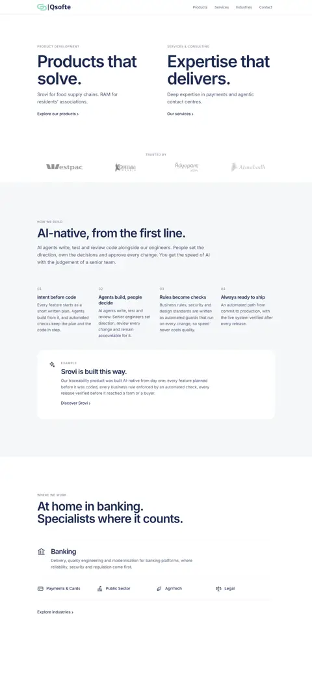
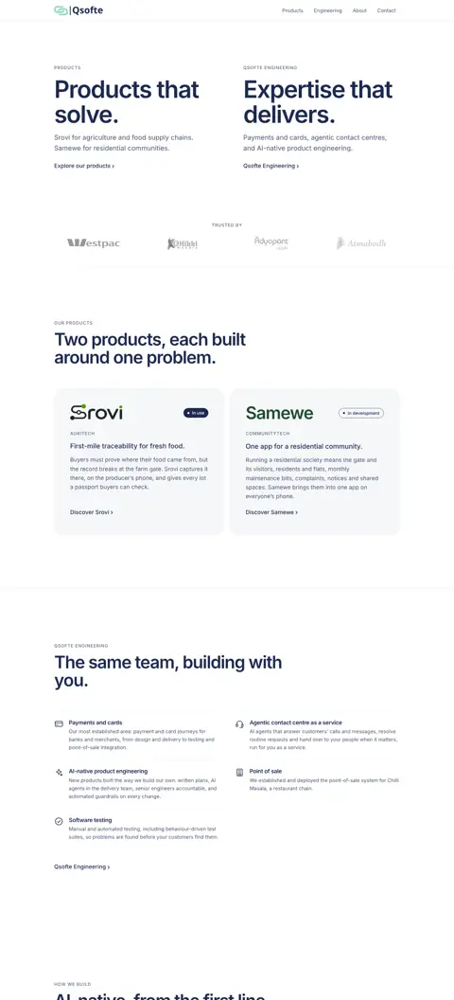
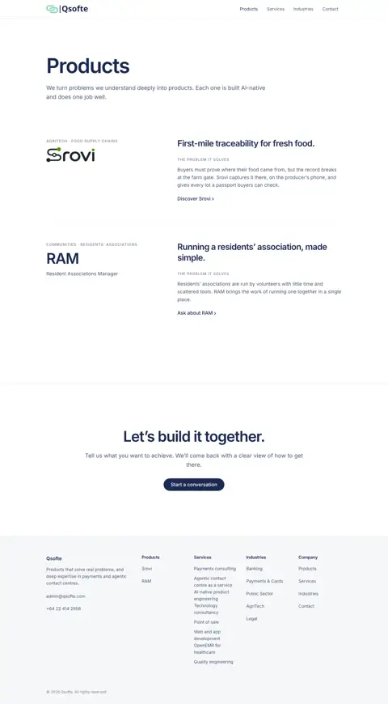
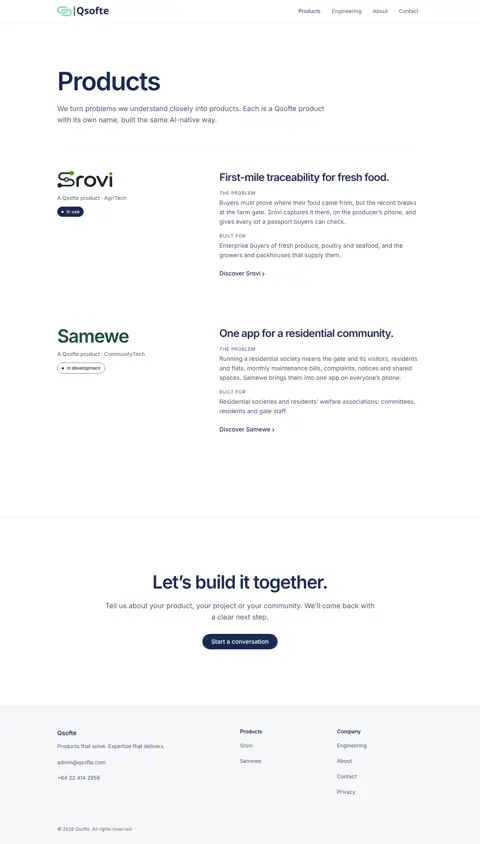
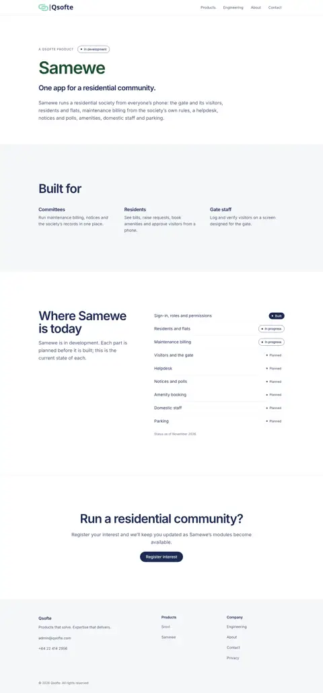
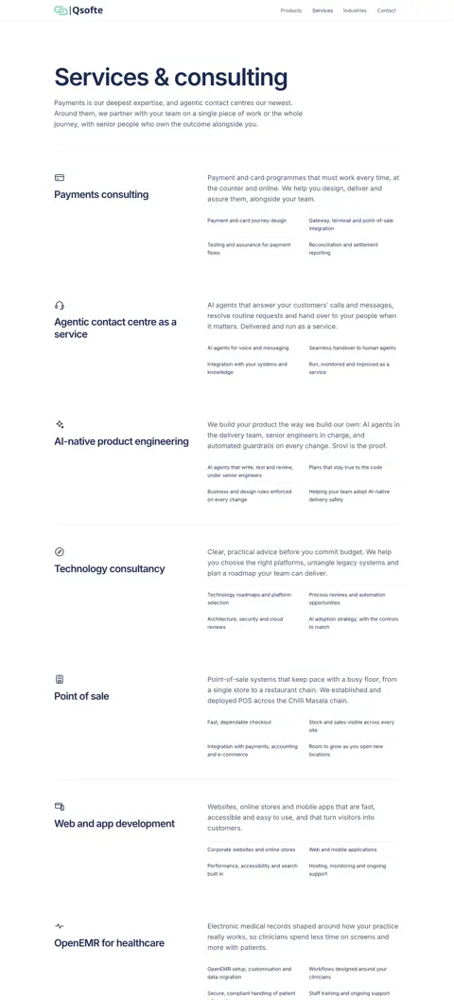
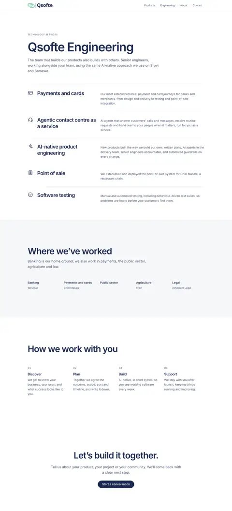

# Qsofte website assessment (November 2026)

This folder records the evidence-based assessment of qsofte.com and the work that
followed. It is the record the "after" measurements are compared against.

| File | What it holds |
| --- | --- |
| `README.md` | Method, baseline findings, scorecard (before and after) |
| `backlog.md` | Prioritised improvement backlog (P0–P3) with acceptance criteria |
| `decisions.md` | Decision log: design, content and architecture choices, and open business decisions |
| `before/`, `after/` | Raw audit data (`audit.json`) and screenshots at phone, tablet and desktop |

## Method

- **Live site.** `https://qsofte.com/` was fetched on 25 Nov 2026. It serves the
  build from `main` at commit `3bcbc33` (PR #30), deployed at 09:55 UTC. The HTML and
  every asset were mirrored and served through the **production nginx configuration**
  (`deploy/nginx/http.conf.template`) so the browser checks match production
  behaviour. A browser could not be pointed at the live URL directly from the
  assessment environment because its network proxy re-signs TLS.
- **Crawler view.** Raw HTML per route, fetched without JavaScript: status, title,
  description, canonical, Open Graph, structured data, `<h1>` count, visible text.
- **Rendered view.** Playwright (Chromium) at three viewports: phone (iPhone 13,
  390 × 844), tablet (768 × 1024, touch) and desktop (1366 × 900). Full-page
  screenshots, horizontal overflow, heading order, console errors.
- **Accessibility.** axe-core 4.10 with WCAG 2.0/2.1/2.2 A and AA rules plus best
  practice. Automated checks find a subset of issues only; see *Limitations*.
- **Performance.** Lighthouse 12.2, mobile and desktop presets. **Lab data on a local
  server**, so network latency to the real host is not represented. No field data
  (CrUX) exists for this origin, so Core Web Vitals from real users, including INP,
  are **not available**.
- **Repository.** Source, tests, CI and deploy configuration; `npm audit`; git
  history for exposed secrets.
- **Product evidence.** Read-only inspection of the product repositories:
  `abhijeet-qsofte/om` (the system behind Srovi) and `abhijeet-qsofte/ram` (Samewe's
  codebase), plus the Srovi executive brief supplied by the owner.

## Product evidence

### Srovi (AgriTech) — in use

Evidence from `om`: public trace endpoints for a crate, batch, box and product unit
(`backend/api/v1/public.py`); an append-only, hash-chained trace ledger with EPCIS
event shapes (`services/trace_ledger*`); time-stamping witness via OpenTimestamps;
a partner ledger gateway (`fabric/`); WhatsApp messaging; delivery signatures;
weight capture from scales; packhouse grading (packout); and a production deploy
workflow (`.github/workflows/deploy-prod.yml`). These support the brief's claims of
tamper evidence, an open standard, a partner ledger, any scale, WhatsApp and being
signed for at both ends.

Not independently verifiable from code: the named buyers (Blinkit, Flipkart) and
"proven in exports". They come from the company's own brief and are presented as such.

### Samewe (CommunityTech) — in development

Evidence from `ram` (`docs/features/*.md` front matter, 12 Nov 2026):

| Module | Status |
| --- | --- |
| Foundation: sign-in, roles, the society's clock | Done |
| Residents and flats | In progress |
| Maintenance billing | In progress |
| Visitor and gate management, helpdesk, notices and polls, amenity booking, domestic staff, parking | Planned |

The product name "Samewe" does not yet appear in the repository (which is named
`ram`). Samewe cannot be presented as available; the site offers early interest.

### Qsofte Engineering

| Capability | Evidence |
| --- | --- |
| AI-native product engineering | The `om` and `ram` repositories: written feature plans checked by CI, design and business-rule guards, AI-agent workflows (`.claude/`, `.windsurf/`) |
| Point of sale | Chilli Masala (owner statement and legacy site logo); `abhijeet-qsofte/eposnow` and `eposnow-cucumber` (POS integration and BDD test suites) |
| Payments and cards | Owner statement; Westpac listed as a client on the original website |
| Agentic contact centre as a service | Owner statement only; no repository evidence was available |
| Software testing | `eposnow-cucumber` (automated BDD tests); the legacy site's testing service |

## Baseline scorecard (live site, commit `3bcbc33`)

| Dimension | Weight | Score | Confidence |
| --- | ---: | ---: | --- |
| Brand and positioning | 10% | 6.0 | Medium |
| UX and visual design | 15% | 7.5 | High |
| Content and messaging | 10% | 5.0 | High |
| Product discoverability | 10% | 5.0 | High |
| SEO | 10% | 4.0 | High |
| Performance | 10% | 9.0 | Medium (lab only) |
| Accessibility | 10% | 7.0 | Medium (automated + code review) |
| Technical architecture | 10% | 8.0 | High |
| Security and privacy | 10% | 4.0 | High |
| Customer engagement | 5% | 6.0 | Medium |
| **Weighted total** | 100% | **6.2 / 10** | |

All ten dimensions could be assessed; none is marked *not assessed*. Performance and
accessibility carry lower confidence because they rest on lab and automated data.

### A. Brand and positioning — 6.0

- **Evidence:** the headline "Products that solve. Expertise that delivers." names
  the two lines of business; the Qsofte logo and navy/mint palette are consistent.
- **Issues:** the approved brand architecture is not reflected. The second product
  appears as "RAM" rather than Samewe; "Qsofte Engineering" does not exist as a name;
  engineering is split across *Services* and *Industries* pages that overlap.
- **Impact:** visitors cannot see one parent brand with two product brands.
- **Recommendation:** adopt the architecture in the navigation, product pages and
  footer.

### B. UX and visual design — 7.5

- **Evidence:** no horizontal overflow on any route at 390, 768 or 1366 px; one type
  scale and spacing scale from tokens; 44 px touch targets enforced by an e2e test;
  no console errors.
- **Issues:** colour-contrast failures on every page (below); *Services* and
  *Industries* duplicate each other; the closing call-to-action repeats on most pages.
- **Recommendation:** fix contrast at the token, consolidate the information
  architecture.

### C. Content and messaging — 5.0

- **Issues (verified):**
  - The RAM description ("run by volunteers with little time and scattered tools")
    was written without evidence. `ram` describes residential societies: gate,
    residents and flats, maintenance billing.
  - The domain capability lists on *Industries* (for example "Core and digital
    banking delivery") have no supporting evidence.
  - "Deep expertise in payments and agentic contact centres" is stated without any
    supporting detail.
  - OpenEMR, website and app development, and quality-engineering copy is carried
    over from the legacy site.
- **Impact:** unsupported claims weaken credibility with enterprise buyers.
- **Recommendation:** claims backed by evidence, with the source recorded in
  `decisions.md`.

### D. Product discoverability — 5.0

- **Evidence:** Srovi has a full page with the problem, the journey, an example
  passport, value pools and a next step.
- **Issues:** the second product has no page, no audience, no status and an invented
  description; neither product states its availability; no real product screenshots
  exist (none were available, and none should be fabricated).
- **Recommendation:** a Samewe page with verified status by module and an
  early-interest path; a status line for both products.

### E. SEO — 4.0

- **Verified issues:**
  - Every route returns the same 1,516-byte HTML shell with an empty `
`:
    no `<h1>` and 107 characters of text without JavaScript.
  - Every route declares the same title, description and **`canonical` =
    `https://qsofte.com/`**, which tells search engines that the product pages are
    duplicates of the home page.
  - No structured data.
  - Unknown URLs return `200` with the app's 404 screen (soft 404s).
  - `www.qsofte.com` has no DNS record.
- **Note:** Lighthouse scores SEO 100 because it executes JavaScript. Link previews
  and non-rendering crawlers still see the empty shell, and the canonical problem
  applies either way.
- **Recommendation:** prerender every route to static HTML with its own metadata;
  real 404s; `Organization` structured data; 301s for retired URLs.

### F. Performance — 9.0 (lab)

| Page | Preset | Perf | LCP | CLS | TBT | Weight |
| --- | --- | ---: | ---: | ---: | ---: | ---: |
| Home | Mobile | 99 | 1.7 s | 0 | 20 ms | 152 KiB |
| Home | Desktop | 100 | 0.4 s | 0 | 0 ms | 152 KiB |
| Srovi | Mobile | 99 | 2.0 s | 0 | 60 ms | 125 KiB |
| Srovi | Desktop | 100 | 0.4 s | 0 | 0 ms | 125 KiB |

- **Other evidence:** system font stack (no font downloads); WebP images; hashed
  assets cached for a year; HTML not cached.
- **Remaining opportunities:** `unsized-images` (client logos), unused JavaScript
  (one 201 KB bundle), responsive image sizes.

### G. Accessibility — 7.0

- **Evidence:** skip link, visible focus ring, `prefers-reduced-motion` honoured,
  labelled form fields, alt text on every image, 16 px inputs.
- **Verified issue:** axe `color-contrast` (serious) on every page: `--ink-3`
  (#7a8399) at 3.79:1 on white and 3.54:1 on `--surface-2`, against 4.5:1 required.
  Affected text includes eyebrows, client labels, passport field names and the
  footer legal line.
- **Not tested:** real screen readers, 200 % text zoom by hand, keyboard-only walk
  through every journey. Full WCAG 2.2 AA conformance is **not** claimed.

### H. Technical architecture — 8.0

- **Evidence:**
  - Vite 5, React 18 and TypeScript (strict); one content module; scoped
    stylesheets.
  - A zero-tolerance design-system guard; 26 unit tests and 32 e2e tests.
  - CI on every PR; Docker and nginx with a certbot renewer.
  - A tag-triggered deploy with post-deploy verification.
- **Issues:**
  - Client-side rendering only (the root cause of section E).
  - No linter; password-based SSH in the deploy (`sshpass`).
  - `Services` and `Industries` duplicate each other's structure.

### I. Security and privacy — 4.0

- **Verified issues:**
  - **P0:** an Azure AD client secret remains in this public repository's history
    (`qsofte-backend/app.js`, removed in #21 but not rotated as far as is known).
  - `react-router-dom` 6.28 is affected by two high-severity open-redirect advisories
    (GHSA-2w69-qvjg-hvjx, GHSA-2j2x-hqr9-3h42). Exploitability is low here (fixed-path
    routes, no data-router redirects), but the patched 6.x release is a drop-in fix.
  - Dev-only advisories in esbuild (via Vite 5) and Vitest.
  - No `Content-Security-Policy` or `Permissions-Policy` header.
  - The contact form collects personal data but there is **no privacy notice**.
  - No spam protection beyond Formspree's defaults.
- **Good:**
  - HTTPS with an HTTP→HTTPS 301 redirect, plus HSTS, `nosniff`, `X-Frame-Options`
    and `Referrer-Policy`.
  - No analytics or tracking scripts; no third-party requests until the form is
    submitted.

### J. Customer engagement — 6.0

- **Evidence:** a working Formspree form with in-page success and error states that
  name the email fallback; `mailto:` and `tel:` links; a clear call to action on
  most pages.
- **Issues:**
  - No product-specific enquiry: Samewe has no early-interest path, and messages do
    not say which product they concern.
  - No conversion measurement (a deliberate privacy choice; see `decisions.md`).

The scorecard after implementation is at the end of this file.

---

## After implementation (branch `claude/adoring-allen-9snc20`)

Measured with the same scripts against the new build, served through the production
nginx configuration (including the new Content-Security-Policy). The browser audit
context bypasses CSP only so that axe can be injected; the e2e suite separately
confirms the CSP causes no violations.

### Scorecard

| Dimension | Weight | Before | After | What changed | Confidence |
| --- | ---: | ---: | ---: | --- | --- |
| Brand and positioning | 10% | 6.0 | 8.5 | Approved architecture in the navigation, product pages, About and footer; Samewe replaces RAM; distinct product marks under "A Qsofte product" | Medium |
| UX and visual design | 15% | 7.5 | 8.5 | Consolidated information architecture; contrast fixed; product and status components; verified at 390, 768 and 1366 px | High |
| Content and messaging | 10% | 5.0 | 8.0 | Unsupported claims removed; every claim sourced (`decisions.md`). Still relies on owner statements for payments depth and the contact-centre offer | High |
| Product discoverability | 10% | 5.0 | 7.5 | Both products show problem, audience, status and a next step; Samewe module status; no real screenshots yet | High |
| SEO | 10% | 4.0 | 9.0 | Prerendered HTML with unique metadata and canonicals; JSON-LD; generated sitemap; real 404s; 301s. Remaining: `www` DNS, social preview image | High |
| Performance | 10% | 9.0 | 9.5 | Lighthouse 100 on every measured page and preset; home weight up 22 KiB (content now in the HTML). Lab only | Medium |
| Accessibility | 10% | 7.0 | 8.5 | Zero axe WCAG 2.2 AA violations on every page at all three viewports; keyboard skip-link test. No manual screen-reader testing | Medium |
| Technical architecture | 10% | 8.0 | 8.5 | Prerender without new runtime dependencies; production-faithful test server; 29 unit and 111 e2e tests; CI asserts 404s, 301s and headers | High |
| Security and privacy | 10% | 4.0 | 6.5 | CSP and Permissions-Policy; high-severity advisories fixed; privacy notice; spam trap. **Capped** by the unrotated secret in git history (P0-1) | High |
| Customer engagement | 5% | 6.0 | 7.5 | Topic routing, Samewe interest path, validated form with honest success and error states; no conversion measurement (by choice) | Medium |
| **Weighted total** | 100% | **6.2** | **8.3** | | |

### Measurements

**Crawler view (raw HTML, no JavaScript)**

| | Before | After |
| --- | --- | --- |
| Distinct titles across pages | 1 | 8 of 8 |
| Canonical | `https://qsofte.com/` on every page | each page's own URL |
| `<h1>` in raw HTML | 0 | 1 per page |
| Visible text in raw HTML | 107 characters | 710–2,962 characters |
| Structured data | none | Organization (home), SoftwareApplication (Srovi) |
| Unknown URL | 200 (soft 404) | 404 |
| Retired URLs (`/services`, `/industries`, `/Connect`) | 200, duplicate content | 301 to `/engineering` or `/contact` |

**Accessibility (axe-core 4.10, WCAG 2.0–2.2 A/AA + best practice)**

| | Before | After |
| --- | --- | --- |
| Pages with violations (phone and desktop) | 7 of 7 | 0 of 9 |
| Colour-contrast failures (home / Srovi / contact) | 11 / 21 / 4 nodes | 0 |

**Lighthouse 12.2 (lab, local server through the production nginx config)**

| Page | Preset | Perf | A11y | Best pr. | SEO | LCP | CLS | TBT | Weight |
| --- | --- | ---: | ---: | ---: | ---: | ---: | ---: | ---: | ---: |
| Home, before | Mobile | 99 | 95 | 100 | 100 | 1.7 s | 0 | 20 ms | 152 KiB |
| Home, after | Mobile | 100 | 100 | 100 | 100 | 1.8 s | 0 | 10 ms | 174 KiB |
| Home, before | Desktop | 100 | 95 | 100 | 100 | 0.4 s | 0 | 0 ms | 152 KiB |
| Home, after | Desktop | 100 | 100 | 100 | 100 | 0.5 s | 0 | 0 ms | 174 KiB |
| Srovi, before | Mobile | 99 | 96 | 100 | 100 | 2.0 s | 0 | 60 ms | 125 KiB |
| Srovi, after | Mobile | 100 | 100 | 100 | 100 | 1.5 s | 0 | 0 ms | 133 KiB |
| Samewe, after (new page) | Mobile | 100 | 100 | 100 | 100 | 1.4 s | 0 | 10 ms | 119 KiB |

Run-to-run variation of ±0.1–0.2 s in LCP is normal for lab runs. Lighthouse
scored SEO 100 before because it runs JavaScript; the crawler-view table shows
the difference that non-rendering crawlers and link previews see.

**Security headers (every response, including 404s)**

| Header | Before | After |
| --- | --- | --- |
| Strict-Transport-Security, nosniff, X-Frame-Options, Referrer-Policy | yes | yes |
| Content-Security-Policy | no | yes (`default-src 'self'`; Formspree for the form only) |
| Permissions-Policy | no | yes |
| `npm audit --omit=dev` | 3 high | 2 moderate (need React Router 7; see backlog P2-8) |

### Screenshots

`before/` and `after/` hold phone, tablet and desktop captures of every page
(WebP, cropped to the top of each page).

| Page | Before (desktop) | After (desktop) |
| --- | --- | --- |
| Home |  |  |
| Products |  |  |
| Samewe | n/a |  |
| Engineering (was Services) |  |  |

### Limitations

- Performance is lab data from a local server; real-user data (CrUX, INP) is not available for this origin.
- Accessibility rests on automated checks, a keyboard test of the skip link and code review. Screen readers and 200% zoom were not tested by hand; WCAG 2.2 AA conformance is not claimed.
- The live TLS certificate could not be inspected from the assessment environment (its proxy re-signs TLS); `cert-monitor.yml` checks it daily from GitHub.
- Product claims are verified against code, not against production usage data.
